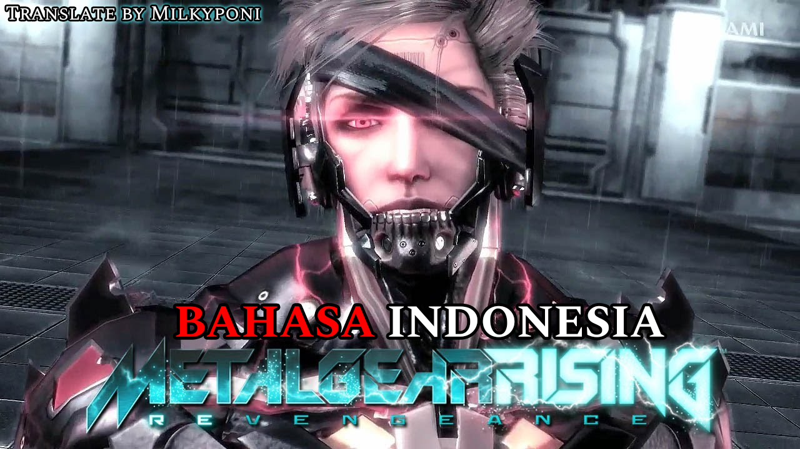

<p align="center">
  
</p>

<h1 align="center">Metal Gear Rising: Revengeance — Indonesian Localization</h1>

<p align="center">
  <b>Mod Lokalisasi & Terjemahan Penuh Bahasa Indonesia untuk Metal Gear Rising: Revengeance (PC / Steam / Steam Deck)</b><br>
  <i>Translate by Milkyponi</i>
</p>

<p align="center">
  <a href="https://github.com/Milkyponi/MGRIndoLocalization/releases"></a>
  
  
  
</p>

---

Mod lokalisasi Bahasa Indonesia untuk mahakarya aksi hack-and-slash legendaris **Metal Gear Rising: Revengeance** (PC) karya **Milkyponi**.

Dibuat khusus untuk memberikan pengalaman sinematik terbaik bagi para pemain Indonesia yang ingin menyelami kisah epik perjuangan cyborg ninja **Raiden** (Jack the Ripper), konspirasi militer PMC *Desperado Enforcement LLC*, perang filosofi dan ideologi kebebasan melawan **Senator Armstrong** (*"Nanomachines, son!"*), serta dua ekspansi cerita DLC penuh: **Jetstream Sam** dan **Blade Wolf** dalam Bahasa Indonesia yang natural, tajam, hidup, dan sarat aksi fiksi ilmiah cyberpunk.

---

## 🌟 Fitur Utama Lokalisasi

### 1. 100% Subtitle Cutscene Cerita Sinematik (Base Game)
- Seluruh 41 adegan sinematik (*Prologue R-00* hingga pertempuran epik puncak *R-07* dan *Epilog*) telah dialihbahasakan secara menyeluruh.
- Naskah mengadaptasi nuansa karakter secara presisi:
  - **Raiden**: Dingin, tajam, filosofis, dan meledak-ledak saat masuk ke mode *Jack the Ripper*.
  - **Boris & Kevin**: Tegas, lugas, dan profesional ala komandan & konsultan PMC Maverick.
  - **Courtney & Doktor**: Hangat, cerdas, informatif, dan sarat istilah teknologi sibernetika.
  - **Para Bos Winds of Destruction (Mistral, Monsoon, Sundowner)**: Menyeramkan, filosofis nihilistik, angkuh, dan penuh aura intimidasi.
  - **Senator Steven Armstrong**: Sangat karismatik, menggelegar, dan penuh darwinisme sosial politik yang mengguncang.

### 2. Deskripsi Senjata, Sub-Weapon & Item Upgrade Bahasa Indonesia
- **100% Naskah Deskripsi Diterjemahkan**: Seluruh naskah fungsi senjata, lore bilah frekuensi tinggi, sub-weapon, dan perlengkapan tempur kini berbahasa Indonesia agar pemain memahami efek dan spesifikasi mekaniknya secara mendalam.
- **Nama Senjata Tetap Original English**: Nama-nama perlengkapan utama (*High-Frequency Blade*, *HF Murasama*, *Stun Blade*, *Armor Breaker*, *Wooden Sword*, *Custom Cyborg Body*, dll.) dipertahankan dalam Bahasa Inggris original demi menjaga kemudahan navigasi menu upgrade dan familiaritas panduan gaming global.

### 3. Panggilan Codec Utama Lengkap
- Ribuan baris percakapan komunikasi Codec interaktif antara Raiden dan seluruh anggota tim Maverick (Boris, Kevin, Courtney, Doktor, Sunny, dan Blade Wolf) kini hadir dalam Bahasa Indonesia penuh.

### 4. Kampanye Penuh DLC Jetstream Sam & DLC Blade Wolf
- **DLC Jetstream Sam (Samuel Rodrigues)**: Seluruh adegan sinematik dan komunikasi radio lapangan saat Sam menginfiltrasi markas World Marshal di Denver. Karakter Sam tampil santai, sinis elegan, karismatik, namun mematikan.
- **DLC Blade Wolf (LQ-84i)**: Perjalanan eksistensial robot serigala cerdas LQ-84i di bawah kendali komandan fanatik Khamsin dan Mistral, berjuang menemukan makna kebebasan dan kesadaran diri.

### 5. In-Game Radio Combat Barks & Celetukan Tempur
- Peringatan status siaga taktis musuh, interkom pengintai jalanan, dialog panduan darurat, hingga celetukan ejekan para bos di tengah sengitnya pertarungan kini terdengar kontekstual.

### 6. Proteksi Biner Opcode Tombol Kontrol (Bit-Perfect HUD)
- Mod ini secara khusus mengisolasi kode biner opcode controller (`0x8003`) beserta ID tombol stik gamepad (`[X]`, `[Y]`, `[LT] HOLD`, dll.).
- **Bebas Glitch**: Petunjuk tombol di *Combat Manual* dan tutorial in-game tampil bersih dan sempurna tanpa bug tanda seru (`!!x!!!!!`) baik pada stik Xbox, PlayStation, maupun Keyboard.

### 7. Non-Destructive Native Loose-File Override (Zero-Risk)
- Mod menggunakan sistem native *file override* bawaan engine PlatinumGames di folder `GameData/`.
- **Tidak membongkar arsip gigabyte (`data000.cpk`)** dan **tidak memodifikasi file eksekusi `.exe`**. Sangat aman, tidak menimbulkan risiko korupsi file game, dan 100% mudah dihapus kapan saja.

---

## 📦 Struktur Paket Distribusi (`MGR_Indo_Mod.zip`)

Paket mod disusun secara modular (*heap-safe*) agar tidak membebani batas alokasi memori internal engine DirectX 9 32-bit bawaan PC:

```text
📦 MGR_Indo_Mod.zip (5.25 MB)
│
├── 📄 CARA_PASANG.txt
│   └── Panduan singkat instalasi dan instruksi uninstall
│
├── 📁 01_Main_Story_dan_Item (WAJIB)/
│   └── 📁 GameData/
│       ├── 📁 ui/     -> 82 file cutscene cerita utama Raiden (Prologue s/d Tamat)
│       └── 📁 ckmsg/  -> 18 file senjata/item, tutorial jalanan pa10, & Codec utama
│
├── 📁 02_DLC_Sam_dan_Blade_Wolf (OPSIONAL)/
│   └── 📁 GameData/
│       ├── 📁 ui/     -> 24 file cutscene cerita Jetstream Sam & Blade Wolf
│       └── 📁 ckmsg/  -> 54 file radio lapangan & gear tempur DLC
│
└── 📁 03_InGame_Combat_Barks_Radio (OPSIONAL)/
    └── 📁 GameData/
        └── 📁 ckmsg/  -> 205 file radio peringatan musuh & ejekan bos saat tempur
```

---

## 📥 Panduan Instalasi (Cara Pasang)

### A. Pengguna Windows (Steam / GOG / Sideload):
1. Unduh file **`MGR_Indo_Mod.zip`** dari halaman [**Releases**](https://github.com/Milkyponi/MGRIndoLocalization/releases).
2. Ekstrak file zip tersebut di PC kamu.
3. Buka folder instalasi game **Metal Gear Rising: Revengeance** kamu (folder yang berisi `METAL GEAR RISING REVENGEANCE.exe` dan folder `GameData`).
   - *Pengguna Steam*: Klik kanan game di Steam Library -> **Manage** -> **Browse local files**.
4. Buka folder **`01_Main_Story_dan_Item (WAJIB)`**, lalu **Copy folder `GameData`** dan **Paste (timpa / merge)** langsung ke dalam folder instalasi game kamu.
5. *(Opsional)* Jika kamu ingin memainkan DLC Sam atau Blade Wolf, buka folder **`02_DLC_Sam_dan_Blade_Wolf (OPSIONAL)`**, lalu salin folder `GameData`-nya ke folder game.
6. Jalankan game, masuk ke menu **OPTIONS** -> **SUBTITLES** -> pastikan diatur ke **ON**.
7. Selamat bermain dalam Bahasa Indonesia!

---

### B. Pengguna Linux / Steam Deck (Heroic Games Launcher / Proton):
1. Buka folder instalasi game di Desktop Mode (misal melalui Steam atau Heroic Games Launcher).
2. Salin folder `GameData` dari **`01_Main_Story_dan_Item (WAJIB)`** ke folder game.
3. Jika menggunakan Proton-GE terbaru pada launcher, pastikan environment variable `PROTON_USE_XALIA=0` aktif untuk performa stik yang paling stabil.
4. Jalankan game dan nikmati permainannya!

---

## 🔄 Cara Uninstall (Kembali ke Bahasa Asli)

Karena mod ini bersifat *non-destructive*, cara mengembalikannya ke versi asli sangat mudah:
1. Masuk ke folder `GameData/` di dalam direktori game kamu.
2. Hapus folder **`ui`** dan **`ckmsg`**.
3. Game seketika akan 100% kembali ke Bahasa Inggris bawaan tanpa perlu install ulang atau verifikasi file.

---

## ⚙️ Teknologi & Toolchain Reverse Engineering

Proyek lokalisasi ini berhasil dieksekusi secara *bit-perfect* berkat riset teknis dan toolchain independen yang dibangun khusus oleh **Fonzy (Head of Software Development, Milky Brain Studio)**:

- **`MGR_Tools` (`mgr_tools.py`)**:
  - **CRIWARE CPK Parser**: Membaca struktur tabel biner `@UTF` dan mengekstrak sub-arsip game tanpa membongkar seluruh data puluhan gigabyte ke disk.
  - **CRILAYLA Bitstream Decompressor**: Dekompresor mandiri algoritma kompresi CRI Middleware untuk mengakses konten arsip terkunci.
  - **PlatinumGames DAT Packer**: Repacker biner format arsip `.dat` PlatinumGames lengkap dengan generator algoritma hashing nama file internal (32-bit custom hash).
  - **MCD Binary Message Container Codec**: Parser dan encoder 2-arah format `.mcd` yang mengunci urutan simbol font asli (*zero re-sorting*) guna menjamin rendering teks tidak menjadi mojibake atau acak.
- **Controller Opcode Isolator (`0x8003`)**: Filter pengaman byte biner untuk mencegah parsing kode kontroler tombol menjadi string literal.
- **WTB Font Texture Sheet Companion Sync**: Otomasi penyandingan lembar tekstur `.dtt` berpasangan untuk mencegah DirectX membatalkan draw-call rendering caption.
- **Heap-Safe Modular Distributor**: Arsitektur pemaket mod berbasis modul untuk mencegah *heap limit overflow* pada engine DirectX 9 32-bit.

---

## 👑 Kredit & Tim Produksi

- **Pemrakarsa & Penerjemah**: [Milkyponi](https://github.com/Milkyponi) (CEO Milky Brain)
- **Banner Artwork**: Milkyponi
- **Lead Developer & Reverse Engineering**: Fonzy (Head of Software Development, Milky Brain)
- **Chief of Staff & Penasehat Teknis**: Bendy (AI Daily, Milky Brain)
- **Studio Produksi**: Milky Brain Studio
- **Pengembang Game Asli**: [PlatinumGames](https://www.platinumgames.com/) & [Konami Digital Entertainment](https://www.konami.com/) (*Metal Gear Rising: Revengeance*)

---

## ⚖️ Penafian & Hak Cipta

Mod ini adalah karya proyek komunitas nirlaba (*non-commercial fan translation*). Seluruh hak cipta aset visual, audio, musik, kode engine, dan karakter adalah milik **PlatinumGames** dan **Konami Digital Entertainment**.
